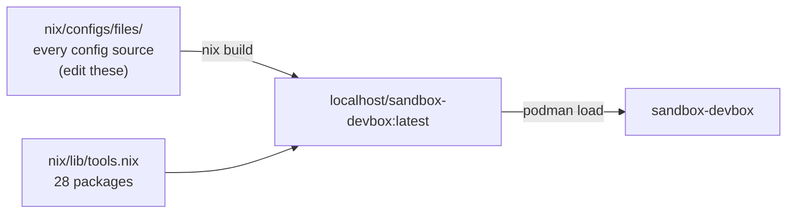

# Sandbox

This repository is a sandbox for AI agents: an unprivileged container for an
agent to work in, two controllers that decide what it can reach, a secrets
server the stack authenticates against, and telemetry backends that watch the
boundary.

The devbox is built from the same configuration sources as everything else in
this repo — it *is* the environment described in
[New machine](./new-machine.md) and [Tools](./tools.md), moved behind a
firewall.


The rule that makes it a sandbox: **the devbox has exactly one default route
and it points at the egress.** It cannot reach the host, the control network,
or the internet except through a controller — and every controller counts,
shapes and reports what crosses it. Secrets are the exception, and deliberately
so: they live in their own container, and only the devbox's sshd and the egress's
proxy read them, never the agent.

## Where the devbox image lives

[`nix/images/devbox.nix`](../nix/images/devbox.nix), built by `nix build` and
loaded with `podman load`. It reads `nix/configs/files/` and
`nix/lib/tools.nix` directly, so an edit to a config source lands in the next
build with nothing to mirror. The sandbox CA is the one thing that is *not* in
it: it is generated per machine and bind-mounted read-only, which is why the
private key can never reach the store.



The other two images this repo owns — the ingress and egress controllers — are
[`nix/images/ingress.nix`](../nix/images/ingress.nix) and
[`nix/images/egress.nix`](../nix/images/egress.nix). The other four containers
are upstream images (OpenBao and the three telemetry backends), pulled by
podman.

## Quick start

Prerequisites are `nix` for the tools and images, and podman from apt (see
[Installing podman](#installing-podman)):

```sh
sudo apt install podman uidmap passt   # the sandbox only
bin/sandbox ca                         # mint the sandbox CA (also done by `up`)
bin/sandbox link                       # link the quadlet units
bin/sandbox up                         # build the images, load, start everything
bin/sandbox check                      # acceptance checks
```

Then:

| From the host | What |
| ------------- | ---- |
| <http://127.0.0.1:9419> | o11ylite UI |
| <http://127.0.0.1:9420> | otel-desktop-viewer UI |
| <http://127.0.0.1:9421> | otelop UI + GraphQL |
| <http://127.0.0.1:8200> | OpenBao — the sandbox's secrets (root token `sandbox-root-token`) |
| `ssh -p 2222 dev@localhost` | the devbox — the image ships an sshd; its authorized keys live in OpenBao, so store one before the first login (see [the devbox README](../sandbox/dev/README.md)) |
| `bin/sandbox shell` | a shell in the devbox |

Seeding the first SSH key, from the host:

```sh
curl -sS -X POST http://127.0.0.1:8200/v1/secret/data/devbox/authorized_keys \
    -H 'X-Vault-Token: sandbox-root-token' \
    -d "{\"data\":{\"authorized_keys\":\"$(cat ~/.ssh/id_ed25519.pub)\"}}"
bin/sandbox exec devbox sshd-init
ssh -p 2222 dev@localhost
```

## Installing podman

Podman is not a nixpkgs entry here — rootless podman from nixpkgs drags in
subuid handling and cgroup setup that is genuinely painful outside NixOS, and
nothing in this repo is blocked by keeping it on apt:

```sh
sudo apt install podman uidmap passt
```

`uidmap` is what makes rootless user namespaces work (`newuidmap`); `passt` is
the rootless networking backend. `podman info` should report no complaints
about either.

Everything else the sandbox needs comes from the flake: the images, the tools,
and the `bao` CLI the devbox's `sshd-init` uses.

## Layout

| Path | What |
| ---- | ---- |
| `sandbox/quadlet/` | the stack, as systemd units: three networks, three volumes, seven containers, and the env files they share |
| `sandbox/bin/sandbox` | the driver (`link`, `up`, `down`, `build`, `ca`, `check`, `rules`, …) |
| `sandbox/bin/check` | acceptance checks |
| `sandbox/ca/` | the sandbox CA, generated by `bin/sandbox ca` (never committed) |
| `nix/images/` | the ingress, egress and devbox images, as nix derivations |
| `sandbox/dev/` | the container's boot sequence: trust the CA, fetch the keys, run sshd |
| `sandbox/ingress/` | inbound DNAT, shaping, counters |
| `sandbox/egress/` | masquerade, DNS, the auth-injecting TLS proxy, shaping, counters |
| `sandbox/openbao/` | the secrets server: authorized keys, outbound auth headers |
| `sandbox/telemetry-*/` | one backend each: o11ylite, otel-desktop-viewer, otelop |

## Full documentation

Topology diagrams, the inbound and outbound paths, the counter model, the
tuning variables, the acceptance checks and the caveats (including the
self-referential route the egress has to delete on boot) are all in
**[`sandbox/README.md`](../sandbox/README.md)**.

Each container explains itself next to its code:

- [Devbox](../sandbox/dev/README.md)
- [Ingress](../sandbox/ingress/README.md)
- [Egress](../sandbox/egress/README.md)
- [OpenBao](../sandbox/openbao/README.md)
- [The sandbox CA](../sandbox/ca/README.md)
- [o11ylite](../sandbox/telemetry-o11ylite/README.md)
- [otel-desktop-viewer](../sandbox/telemetry-otel-desktop-viewer/README.md)
- [otelop](../sandbox/telemetry-otelop/README.md)

## Why three telemetry containers

Because the counters are emitted as OTLP spans to all three at once, so the
same numbers can be compared through three different stores — one all-in-one
(o11ylite), one built for a quick look (otel-desktop-viewer), one with
retention and a GraphQL API (otelop). None of them is the LGTM stack; all of
them are small enough to leave running.
