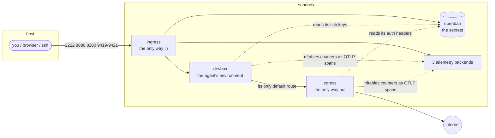
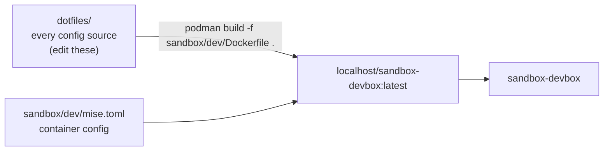

# Sandbox

This repository is a sandbox for AI agents: an unprivileged container for an
agent to work in, two controllers that decide what it can reach, a secrets
server the stack authenticates against, and telemetry backends that watch the
boundary.

The devbox is built from the same dotfiles as everything else in this repo —
it *is* the environment described in [New machine](./new-machine.md) and
[Tools](./tools.md), moved behind a firewall.



The rule that makes it a sandbox: **the devbox has exactly one default route
and it points at the egress.** It cannot reach the host, the control network,
or the internet except through a controller — and every controller counts,
shapes and reports what crosses it. Secrets are the exception, and deliberately
so: they live in their own container, and only the devbox's sshd and the egress's
proxy read them, never the agent.

## Where the devbox image lives

The devbox Dockerfile was the repo root's `Dockerfile`; it now lives in
`sandbox/dev/`. The image builds from the repository root and copies four
things: the `dotfiles/` folder with every config source, `sandbox/dev/mise.toml`
(the container's own copy of the manifest), `sshd-init.sh`, and the generated
sandbox CA. There is no mirror of the sources to refresh, so an edit to a
dotfile lands in the next build.



## Quick start

Prerequisites come from `[bootstrap.packages]` in the repo-root `mise.toml`
(see [Installing podman](#installing-podman)) — it installs podman,
podman-compose and rootless networking helpers:

```sh
cd /workspace && mise bootstrap # tools, dotfiles and the apt packages
cd sandbox
bin/sandbox up                  # create the networks, build, start everything
bin/sandbox check               # acceptance checks
```

Then:

| From the host | What |
| ------------- | ---- |
| <http://127.0.0.1:9419> | o11ylite UI |
| <http://127.0.0.1:9420> | otel-desktop-viewer UI |
| <http://127.0.0.1:9421> | otelop UI + GraphQL |
| <http://127.0.0.1:8200> | OpenBao — the sandbox's secrets (root token `sandbox-root-token`) |
| `ssh -p 2222 dev@localhost` | the devbox — the image ships an sshd; its authorized keys live in OpenBao, so store one before the first login (see [the devbox README](../sandbox/dev/README.md)) |
| `bin/sandbox shell` | a shell in the devbox |

Seeding the first SSH key, from the host:

```sh
curl -sS -X POST http://127.0.0.1:8200/v1/secret/data/devbox/authorized_keys \
    -H 'X-Vault-Token: sandbox-root-token' \
    -d "{\"data\":{\"authorized_keys\":\"$(cat ~/.ssh/id_ed25519.pub)\"}}"
bin/sandbox exec devbox sshd-init
ssh -p 2222 dev@localhost
```

## Installing podman

Podman is not a mise `[tools]` entry — it needs capabilities a per-user binary
cannot set up — so it is declared in `[bootstrap.packages]` in the repo-root
`mise.toml` and installed with `apt` by `mise bootstrap`:

```toml
[bootstrap.packages]
"apt:podman" = "latest"
"apt:podman-compose" = "latest"
"apt:uidmap" = "latest"      # rootless user namespaces
"apt:passt" = "latest"       # rootless networking
```

`mise bootstrap packages status` reports whether they are present.

## Layout

| Path | What |
| ---- | ---- |
| `sandbox/compose.yaml` | the stack: three networks, seven containers |
| `sandbox/bin/sandbox` | the driver (`up`, `down`, `build`, `ca`, `check`, `rules`, …) |
| `sandbox/bin/networks` | creates the three networks, whose options compose cannot express |
| `sandbox/bin/check` | acceptance checks |
| `sandbox/ca/` | the sandbox CA, generated by `bin/sandbox ca` (never committed) |
| `sandbox/dev/` | devbox Dockerfile + the container's `mise.toml` + the sshd boot helper (built against the repo root's `dotfiles/`) |
| `sandbox/ingress/` | inbound DNAT, shaping, counters |
| `sandbox/egress/` | masquerade, DNS, the auth-injecting TLS proxy, shaping, counters |
| `sandbox/openbao/` | the secrets server: authorized keys, outbound auth headers |
| `sandbox/telemetry-*/` | one backend each: o11ylite, otel-desktop-viewer, otelop |

## Full documentation

Topology diagrams, the inbound and outbound paths, the counter model, the
tuning variables, the acceptance checks and the caveats (including the
self-referential route the egress has to delete on boot) are all in
**[`sandbox/README.md`](../sandbox/README.md)**.

Each container explains itself next to its Dockerfile:

- [Devbox](../sandbox/dev/README.md)
- [Ingress](../sandbox/ingress/README.md)
- [Egress](../sandbox/egress/README.md)
- [OpenBao](../sandbox/openbao/README.md)
- [The sandbox CA](../sandbox/ca/README.md)
- [o11ylite](../sandbox/telemetry-o11ylite/README.md)
- [otel-desktop-viewer](../sandbox/telemetry-otel-desktop-viewer/README.md)
- [otelop](../sandbox/telemetry-otelop/README.md)

## Why three telemetry containers

Because the counters are emitted as OTLP spans to all three at once, so the
same numbers can be compared through three different stores — one all-in-one
(o11ylite), one built for a quick look (otel-desktop-viewer), one with
retention and a GraphQL API (otelop). None of them is the LGTM stack; all of
them are small enough to leave running.
