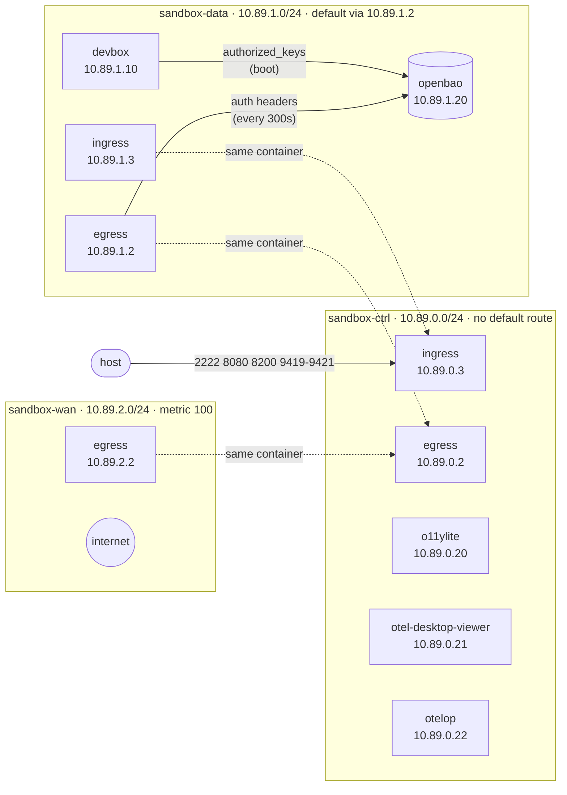
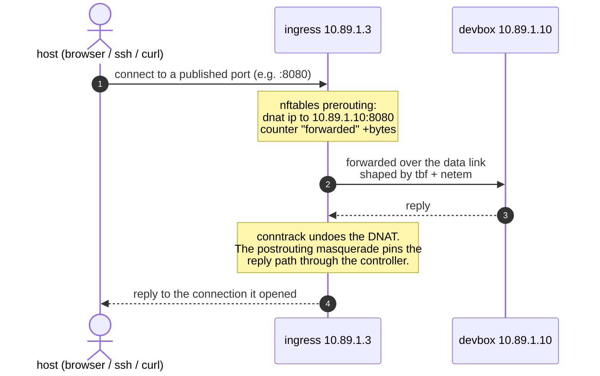
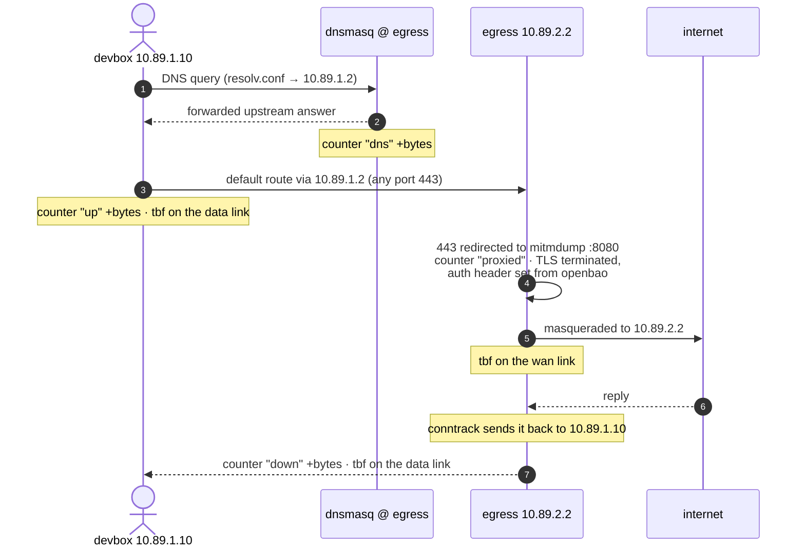
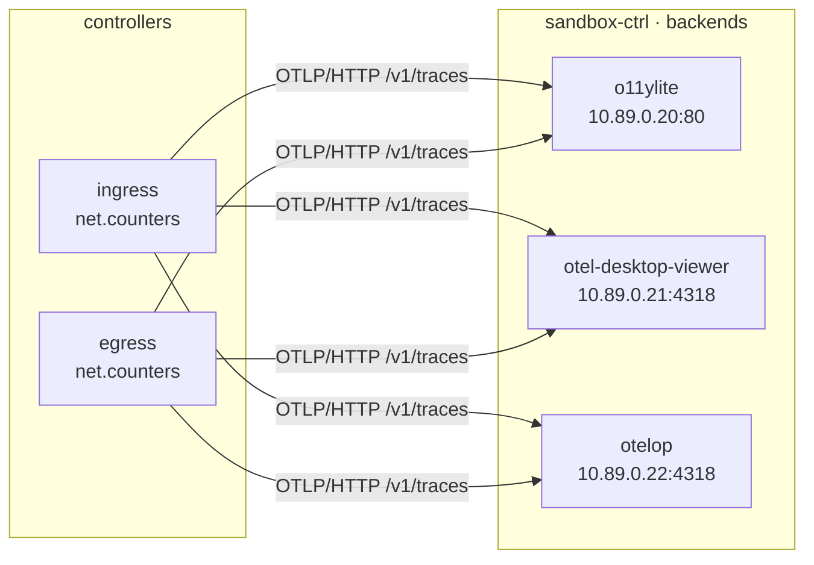

# Sandbox

A multi-container sandbox for AI agents: a devbox to work in, two controllers
that decide what it can reach in and out, a secrets server it authenticates
against, and three telemetry backends that watch the boundary.

| Container | Role |
| --------- | ---- |
| `sandbox-devbox` | The environment the agent works in, built from [`nix/images/devbox.nix`](../nix/images/devbox.nix) out of the repo's [`nix/configs/files/`](../nix/configs/files) and the toolchain in [`nix/lib/tools.nix`](../nix/lib/tools.nix) — the same sources a fresh machine uses. Unprivileged, no sudo, no other way to escalate. Runs its own sshd on `2222`, with the keys that may log in served by OpenBao rather than baked in. |
| `sandbox-ingress` | The **only way in**. Terminates the published host ports, DNATs each one to its backend, shapes the devbox-facing link, counts what it forwards. |
| `sandbox-egress` | The **only way out**. The devbox's default gateway: masquerades to the WAN, answers the devbox's DNS, shapes and counts upload/download — and decrypts the devbox's outbound `https` to put auth headers on it, with the values read from OpenBao so no key ever lives in the devbox. |
| `sandbox-openbao` | The **secrets server**. Holds the devbox's authorized keys and the egress's auth headers. Reached by those two over the data network, published to the host as `:8200`; the agent has no client for it. |
| `sandbox-telemetry-*` | One container per backend, all fed the same spans so three stores and three UIs can be compared side by side. |

The design rule is simple: **the devbox has exactly one default route, and it
points at the egress.** It cannot reach the host, the control network, or the
internet except through a controller.

## Layout

```
sandbox/
  quadlet/                the whole stack: 3 networks, 3 volumes, 7 containers
    README.md             why each unit looks the way it does
    environments/         one env file per service, shared by the unit and
                          `bin/sandbox rules`
  bin/
    sandbox               driver: link, build, up, down, clean, ca, check, …
    check                 acceptance checks
  ca/
    README.md             the sandbox CA; the files next to it are generated by
                          `bin/sandbox ca` and never committed
  dev/
    devbox-init.sh        container start: trust the CA, then sshd
    sshd-init.sh          fetches the sshd's authorized keys from OpenBao on boot
    README.md             the devbox image, its sshd, and the CA
  ingress/
    entrypoint.sh, metrics.sh
    README.md             DNAT, shaping, counters, environment variables
  egress/
    entrypoint.sh, metrics.sh, dnsmasq.conf
    auth_inject.py        mitmproxy addon: auth headers from OpenBao
    README.md             masquerade, DNS, auth injection, shaping, variables
  openbao/
    Dockerfile            the secrets server (dev mode: in-memory, fixed token)
    README.md             secrets layout, recipes, rotation
  telemetry-o11ylite/            Dockerfile, README.md
  telemetry-otel-desktop-viewer/ Dockerfile, README.md
  telemetry-otelop/              Dockerfile, README.md

The images come from the repo's flake (nix/images/), not from Dockerfiles:

  nix build .#sandbox-images && podman load < result
  bin/sandbox build          # the same thing, one image at a time, plus the CA
```

## Topology

Three bridge networks. Each one exists for a reason:

| Network | Subnet | Why it has these options |
| ------- | ------ | ------------------------ |
| `sandbox-ctrl` | `10.89.0.0/24` | `no_default_route=1` — the control plane never reaches the internet on its own. |
| `sandbox-data` | `10.89.1.0/24` | `no_default_route=1` **plus** `--route 0.0.0.0/0,10.89.1.2,1000` — the devbox's *only* way out is the egress container. |
| `sandbox-wan` | `10.89.2.0/24` | `metric=100` — the egress prefers this default over the self-referential one the data network installs (see [Caveats](#caveats)). |

DNS is disabled on all three (`DisableDNS=true`): containers address each other
by static IP, so the DNAT rules can name their targets, and the devbox's
resolver is the egress container — name resolution travels the same path as
everything else.



A box appears once per network because a container on two networks holds an
address in each — the dotted links are the same container, not extra ones.

### Addresses

| Container | ctrl | data | wan |
| --------- | ---- | ---- | --- |
| egress | `10.89.0.2` | `10.89.1.2` | `10.89.2.2` |
| ingress | `10.89.0.3` | `10.89.1.3` | — |
| devbox | — | `10.89.1.10` | — |
| openbao | — | `10.89.1.20` | — |
| telemetry-o11ylite | `10.89.0.20` | — | — |
| telemetry-otel-desktop-viewer | `10.89.0.21` | — | — |
| telemetry-otelop | `10.89.0.22` | — | — |

The data network is also where the secrets live: only the devbox and the egress
are on it, and each reads exactly one thing from OpenBao. The agent has no
client for it and no token — see [`openbao/README.md`](./openbao/README.md).

## The way in

Every host port is published on the ingress container and rewritten there.
Nothing else on the host has a path to the devbox.



| Host port | DNAT target | What it is |
| --------- | ----------- | ---------- |
| `2222` | `10.89.1.10:2222` | SSH into the devbox — the image ships an sshd, listening inside on `2222` because the unprivileged `dev` user cannot bind 22 |
| `8080` | `10.89.1.10:8080` | a demo HTTP listener you start yourself |
| `8200` | `10.89.1.20:8200` | OpenBao's API and web UI — where you put the sandbox's secrets |
| `9419` | `10.89.0.20:80` | o11ylite web UI |
| `9420` | `10.89.0.21:8000` | otel-desktop-viewer web UI |
| `9421` | `10.89.0.22:4319` | otelop web UI + GraphQL |

The list lives in one place: the `FORWARDS` variable in
[`environments/ingress.env`](./quadlet/environments/ingress.env), as
`host-port:target-ip:target-port`, space-separated. The ingress derives its
ruleset from it, so adding a port is an edit to that list plus a matching
`PublishPort=` in
[`sandbox-ingress.container`](./quadlet/sandbox-ingress.container).

All of them are published on **loopback**. Nothing outside the host has any
business reaching the devbox's sshd, or OpenBao with its fixed dev-mode root
token.

To start the demo listener the `8080` forward points at:

```sh
bin/sandbox shell devbox
node -e 'require("http").createServer((q,s)=>s.end("hello from the sandbox")).listen(8080)'
curl http://127.0.0.1:8080/    # from the host, through the ingress
```

SSH is public-key only, and **the keys live in OpenBao, not in the image** — so
who may log in is a secret edit, not a rebuild. Store your public key once:

```sh
curl -sS -X POST http://127.0.0.1:8200/v1/secret/data/devbox/authorized_keys \
    -H 'X-Vault-Token: sandbox-root-token' \
    -d "{\"data\":{\"authorized_keys\":\"$(cat ~/.ssh/id_ed25519.pub)\"}}"

bin/sandbox exec devbox sshd-init     # or: restart the devbox
ssh -p 2222 dev@127.0.0.1              # through the ingress
```

Until a key is stored, every login is refused and the devbox is reachable only
through `bin/sandbox shell`. The whole flow, including rotation, is in
[`dev/README.md`](./dev/README.md); the secret is one KV entry in
[`openbao/README.md`](./openbao/README.md).

## The way out

The devbox's `resolv.conf` and its default route both point at the egress
container, so DNS and everything else cross the same boundary.



### Auth headers, without the keys

The devbox's agent needs an API key for whatever LLM or MCP provider it calls.
Putting that key in the devbox would put it one `cat` away from the agent, so
the key lives in OpenBao and the **egress** puts it on the wire: it decrypts the
devbox's outbound `https` (which is why the devbox trusts the [sandbox
CA](./ca/README.md)), reads the value from `secret/egress/<provider>` every five
minutes, and sets the header — overwriting whatever the agent sent, so it can
neither read nor forge one.

It is armed by `HEADER_JOBS` in
[`environments/egress.env`](./quadlet/environments/egress.env) and entirely
optional: with it
empty the devbox's `https` goes out untouched. The wiring, the secret layout,
rotation and what this costs are in [`egress/README.md`](./egress/README.md).

## Telemetry

Both controllers run [otel-cli] and emit one span per interval named
`net.counters`, with the nftables byte counters as attributes. otel-cli is a
traces-only tool — there is no metrics command — so the counters ride as span
attributes rather than as a metrics pipeline. Both controllers fan every span
out to **all three** backends, which is the point: the same numbers through
three different stores.



The web UIs are *not* published on the host — they are reachable only through
the ingress (ports `9419`, `9420`, `9421`). See each backend's own README for
its ports, storage and trade-offs:

- [o11ylite](./telemetry-o11ylite/README.md) — OTLP + UI on one port, DuckDB/DuckLake, traces, logs and metrics.
- [otel-desktop-viewer](./telemetry-otel-desktop-viewer/README.md) — UI on `8000`, OTLP on `4317`/`4318`, DuckDB.
- [otelop](./telemetry-otelop/README.md) — UI + GraphQL on `4319`, OTLP on `4317`/`4318`, DuckDB with retention.

### Counters

| Counter | Controller | Meaning |
| ------- | ---------- | ------- |
| `forwarded` | ingress | bytes through the ingress's forward path (inbound traffic) |
| `up` | egress | bytes leaving the data link towards the internet |
| `down` | egress | bytes leaving the data link towards the devbox |
| `dns` | egress | bytes of DNS served to the devbox |
| `proxied` | egress | bytes of the devbox's outbound TLS requests, counted where the proxy redirect fires — **requests only**, and only when the auth proxy is armed |

They are plain nftables counters, so they are visible without any telemetry at
all:

```sh
bin/sandbox nft egress
bin/sandbox nft ingress
```

## Prerequisites

Podman and rootless networking come from apt, plus Nix for the tools and the
images — see [New machine](../docs/new-machine.md):

```sh
sudo apt install podman uidmap passt   # per-user podman cannot set up rootless
                                       # networking on its own
# nix, per https://nixos.org/download (single-user install is fine)
```

## Usage

```sh
bin/sandbox link          # link the quadlet units into ~/.config/containers/systemd
bin/sandbox up            # link, build, start everything
bin/sandbox ca            # mint the sandbox CA (also done by `build` and `up`)
bin/sandbox check         # acceptance checks
bin/sandbox ps            # what is running
bin/sandbox logs egress   # follow one service (or all)
bin/sandbox shell         # shell into the devbox
bin/sandbox rules ingress # print the nftables ruleset a controller would install
bin/sandbox nft egress    # show a controller's live ruleset
bin/sandbox down          # stop and remove the containers
bin/sandbox clean         # stop, drop volumes, images and networks
```

Edits to a config source reach the image on the next build: `nix build` reads
`nix/configs/files/` directly, so there is nothing to sync first. Edits to a
*.container unit only need a re-link:

```sh
bin/sandbox link && systemctl --user restart sandbox-ingress
```

```sh
bin/sandbox build         # nix build + podman load, for all three images
```

### Turning the knobs

Everything is an environment variable in
[`quadlet/environments/`](./quadlet/environments/), one file per service:

| Variable | Where | Effect |
| -------- | ----- | ------ |
| `RATE`, `DELAY`, `LOSS` | ingress | shaping of the devbox-facing link |
| `UP_RATE`, `DOWN_RATE`, `DELAY`, `LOSS` | egress | shaping of the WAN and data links |
| `FORWARDS` | ingress | the port map: `host-port:target-ip:target-port` |
| `OTEL_ENDPOINTS` | both | which backends receive the counter spans |
| `DNS_UPSTREAM` | egress | where dnsmasq forwards |
| `METRICS_INTERVAL` | both | seconds between counter spans |
| `HEADER_JOBS` | egress | which hosts get auth headers injected, and from which secret; empty disables the proxy |
| `BAO_ADDR`, `BAO_TOKEN` | devbox, egress | how those two reach the secrets server |
| `BAO_RESYNC` | egress | seconds between secret re-reads (`0` = once at boot) |
| `BAO_DEV_ROOT_TOKEN_ID` | openbao | the dev-mode root token the two clients above use |

Shape it and watch the counters move:

```sh
# 1 Mbit/s download from the devbox's point of view
sed -i 's/^DOWN_RATE=.*/DOWN_RATE=1mbit/' sandbox/quadlet/environments/egress.env
bin/sandbox up
bin/sandbox shell devbox && curl -o /dev/null https://example.com/big.file
bin/sandbox nft egress    # counter "down" should climb in steps, not smoothly
```

## Checks

`bin/sandbox check` reports PASS/FAIL/SKIP per item:

- the three networks exist and all seven containers are running;
- the devbox's default route is the egress, and the egress's default route no
  longer points at itself;
- the devbox resolves names through the egress and reaches the internet;
- the devbox reaches OpenBao's health endpoint across the data network;
- the devbox's sshd is listening on 2222, and whether any authorized keys were
  provisioned for it;
- the controllers have their rules, counters and qdiscs installed;
- the auth proxy is running, its `proxied` counter and redirect are installed,
  and the devbox trusts the sandbox CA;
- the three telemetry UIs are reachable **from a controller** (the control
  network path the controllers use);
- the published host ports reach those UIs through the ingress, and `:8200`
  reaches OpenBao.

## Changing things later

Every knob is an environment variable or a secret; the few that are *not* are
called out, because they mean a rebuild. The per-component READMEs have the
detail — this is the map of which file to open.

| To change | Edit | Rebuild? |
| --------- | ---- | -------- |
| which hosts get auth headers, and from which secret | `HEADER_JOBS` in `environments/egress.env` + the secret in OpenBao | no |
| a header value (a rotated API key, a new SSH key) | the OpenBao secret | no |
| seconds between secret re-reads, log noise | `BAO_RESYNC`, `MITM_VERBOSITY` | no |
| the root token | `BAO_DEV_ROOT_TOKEN_ID` + `BAO_TOKEN` in two services (all three, together) | no |
| how much of the devbox's traffic is intercepted | `DEVBOX_IP`, `SANDBOX_NETS`, `PROXY_PORT` | no |
| shaping, DNS, telemetry | the `*_RATE`/`DELAY`/`LOSS`/`OTEL_*` variables | no |
| a published host port | `FORWARDS` in `environments/ingress.env` and `PublishPort=` in the unit | no |
| which keys may log into the devbox | `secret/devbox/authorized_keys` | no |
| **the sandbox CA** | `bin/sandbox ca` | **yes** — the devbox image has the certificate baked in |
| **the devbox's sshd port** | `Port` in `nix/configs/files/sshd/sshd_config`, `FORWARDS`, `PublishPort=`, and the port `bin/check` probes | **yes** |
| the devbox's tools or config files | `nix/lib/tools.nix`, `nix/configs/files/` | **yes** |

After a rebuild of the devbox its **host key** is regenerated too, so a client
with a cached `known_hosts` entry for `[127.0.0.1]:2222` complains once — drop
that line and reconnect.

## Caveats

**The self-referential route.** The data network's `--route` is installed in
*every* member, including the egress container itself, so on boot the egress
briefly has `default via 10.89.1.2` — a route to itself. Its entrypoint deletes
that route and falls back to the WAN default (metric `100` beats `1000` in the
window before it runs). This is the first thing to check on a new host:

```sh
podman exec sandbox-egress ip route show default
```

**The reply path must come back through the ingress.** The backends sit on the
same networks as the host's port proxy, so a bare DNAT would let a reply go
straight out over the bridge and never reach the controller — the proxy would
then see a reply from an address it never connected to. The ingress
masquerades everything it forwards to its own address to pin the return path,
and conntrack undoes the rewrite on the way back.

**Rootless vs root.** The controllers need `NET_ADMIN` and `NET_RAW`, and
nothing else. They are deliberately unprivileged beyond that: shaping and
nftables live in the container's own network namespace.

**The secrets are dev-mode secrets.** OpenBao keeps everything in memory, so a
restart wipes it (the devbox re-reads its keys on the next boot, the egress on
its next resync — both fail closed: nobody can log in, providers answer 401).
The root token sits in `sandbox/quadlet/environments/openbao.env`, so anyone
with the repo has it. And the
egress is a TLS man-in-the-middle the devbox is built to trust: everything the
devbox fetches is readable there in plain text. The sandbox models *egress
shaping and observability*, not defence against someone who already has the
repo.

**The networks come first, automatically.** Each container unit that joins a
network gets `Requires=` and `After=` on it, so systemd starts the three
networks before anything that needs them. There is no ordering left to
maintain by hand, and `no_default_route` and `--route` are declared in
[`sandbox-data.network`](./quadlet/sandbox-data.network) next to the subnet
they belong to.

**Only validation you can do without a VM.** The scripts, the units, both
nftables rulesets and the proxy addon are checkable anywhere:

```sh
sh -n sandbox/bin/* sandbox/*/entrypoint.sh sandbox/*/metrics.sh \
      sandbox/dev/*.sh
python3 -m py_compile sandbox/egress/auth_inject.py
nix flake check                     # every derivation and tool attribute evaluates
sandbox/bin/sandbox rules ingress | unshare -rn nft -c -f /dev/stdin
sandbox/bin/sandbox rules egress | unshare -rn nft -c -f /dev/stdin
```

Running the stack needs a machine where containers can actually start — a VM
or bare metal. Inside a container that lacks `/dev/net/tun`, a writable
`/sys/fs/cgroup` and permission to mount `proc`, the containers will not start
and that is an environment limit, not a defect in the stack.

[otel-cli]: https://github.com/equinix-labs/otel-cli
