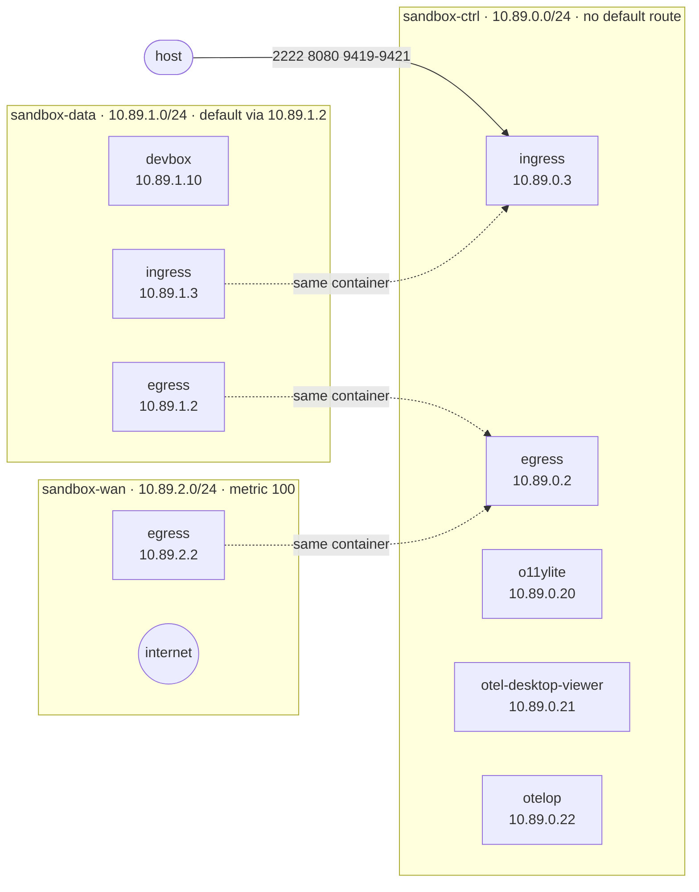
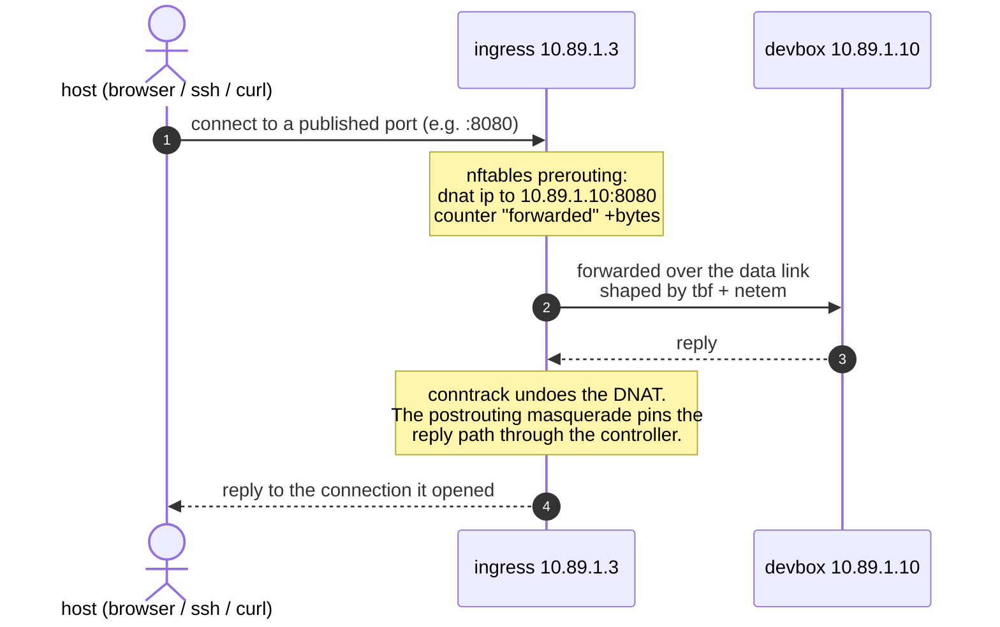
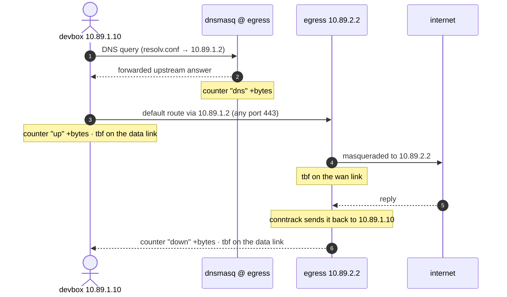
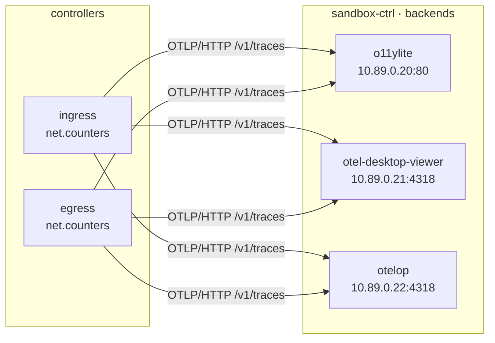

# Sandbox

A multi-container sandbox for AI agents: a devbox to work in, two controllers
that decide what it can reach in and out, and three telemetry backends that
watch the boundary.

| Container | Role |
| --------- | ---- |
| `sandbox-devbox` | The environment the agent works in, built from [`dev/Dockerfile`](./dev/Dockerfile) against the repo's [`dotfiles/`](../dotfiles) folder and the container config [`dev/mise.toml`](./dev/mise.toml) — the same sources a fresh machine, and the VM host later, use. Unprivileged, no sudo, no other way to escalate. |
| `sandbox-ingress` | The **only way in**. Terminates the published host ports, DNATs each one to its backend, shapes the devbox-facing link, counts what it forwards. |
| `sandbox-egress` | The **only way out**. The devbox's default gateway: masquerades to the WAN, answers the devbox's DNS, shapes and counts upload/download. |
| `sandbox-telemetry-*` | One container per backend, all fed the same spans so three stores and three UIs can be compared side by side. |

The design rule is simple: **the devbox has exactly one default route, and it
points at the egress.** It cannot reach the host, the control network, or the
internet except through a controller.

## Layout

```
sandbox/
  compose.yaml            the whole stack: 3 networks, 6 containers
  bin/
    sandbox               driver: up, down, build, check, rules, logs, …
    networks              creates/removes the three networks (their options
                          cannot be expressed in compose.yaml)
    check                 acceptance checks
  dev/
    Dockerfile            the devbox image (context = repo root; copies dotfiles/)
    mise.toml             the container's config: [tools] + [dotfiles]
  ingress/
    Dockerfile, entrypoint.sh, metrics.sh
    README.md             DNAT, shaping, counters, environment variables
  egress/
    Dockerfile, entrypoint.sh, metrics.sh, dnsmasq.conf
    README.md             masquerade, DNS, shaping, counters, variables
  telemetry-o11ylite/            Dockerfile, README.md
  telemetry-otel-desktop-viewer/ Dockerfile, README.md
  telemetry-otelop/              Dockerfile, README.md
```

## Topology

Three bridge networks. Each one exists for a reason:

| Network | Subnet | Why it has these options |
| ------- | ------ | ------------------------ |
| `sandbox-ctrl` | `10.89.0.0/24` | `no_default_route=1` — the control plane never reaches the internet on its own. |
| `sandbox-data` | `10.89.1.0/24` | `no_default_route=1` **plus** `--route 0.0.0.0/0,10.89.1.2,1000` — the devbox's *only* way out is the egress container. |
| `sandbox-wan` | `10.89.2.0/24` | `metric=100` — the egress prefers this default over the self-referential one the data network installs (see [Caveats](#caveats)). |

DNS is disabled on all three (`--disable-dns`): containers address each other
by static IP, so the DNAT rules can name their targets, and the devbox's
resolver is the egress container — name resolution travels the same path as
everything else.



A box appears once per network because a container on two networks holds an
address in each — the dotted links are the same container, not extra ones.

### Addresses

| Container | ctrl | data | wan |
| --------- | ---- | ---- | --- |
| egress | `10.89.0.2` | `10.89.1.2` | `10.89.2.2` |
| ingress | `10.89.0.3` | `10.89.1.3` | — |
| devbox | — | `10.89.1.10` | — |
| telemetry-o11ylite | `10.89.0.20` | — | — |
| telemetry-otel-desktop-viewer | `10.89.0.21` | — | — |
| telemetry-otelop | `10.89.0.22` | — | — |

## The way in

Every host port is published on the ingress container and rewritten there.
Nothing else on the host has a path to the devbox.



| Host port | DNAT target | What it is |
| --------- | ----------- | ---------- |
| `2222` | `10.89.1.10:22` | SSH into the devbox — only if you start an sshd, the image has none |
| `8080` | `10.89.1.10:8080` | a demo HTTP listener you start yourself |
| `9419` | `10.89.0.20:80` | o11ylite web UI |
| `9420` | `10.89.0.21:8000` | otel-desktop-viewer web UI |
| `9421` | `10.89.0.22:4319` | otelop web UI + GraphQL |

The list lives in one place: the `FORWARDS` variable in
[`compose.yaml`](./compose.yaml), `host-port:target-ip:target-port`, one entry
per line. The ingress derives its ruleset from it, so adding a port is an edit
to that list plus a matching entry under `ports:`.

To start the demo listener the `8080` forward points at:

```sh
bin/sandbox shell devbox
node -e 'require("http").createServer((q,s)=>s.end("hello from the sandbox")).listen(8080)'
curl http://127.0.0.1:8080/    # from the host, through the ingress
```

## The way out

The devbox's `resolv.conf` and its default route both point at the egress
container, so DNS and everything else cross the same boundary.



## Telemetry

Both controllers run [otel-cli] and emit one span per interval named
`net.counters`, with the nftables byte counters as attributes. otel-cli is a
traces-only tool — there is no metrics command — so the counters ride as span
attributes rather than as a metrics pipeline. Both controllers fan every span
out to **all three** backends, which is the point: the same numbers through
three different stores.



The web UIs are *not* published on the host — they are reachable only through
the ingress (ports `9419`, `9420`, `9421`). See each backend's own README for
its ports, storage and trade-offs:

- [o11ylite](./telemetry-o11ylite/README.md) — OTLP + UI on one port, DuckDB/DuckLake, traces, logs and metrics.
- [otel-desktop-viewer](./telemetry-otel-desktop-viewer/README.md) — UI on `8000`, OTLP on `4317`/`4318`, DuckDB.
- [otelop](./telemetry-otelop/README.md) — UI + GraphQL on `4319`, OTLP on `4317`/`4318`, DuckDB with retention.

### Counters

| Counter | Controller | Meaning |
| ------- | ---------- | ------- |
| `forwarded` | ingress | bytes through the ingress's forward path (inbound traffic) |
| `up` | egress | bytes leaving the data link towards the internet |
| `down` | egress | bytes leaving the data link towards the devbox |
| `dns` | egress | bytes of DNS served to the devbox |

They are plain nftables counters, so they are visible without any telemetry at
all:

```sh
bin/sandbox nft egress
bin/sandbox nft ingress
```

## Prerequisites

Podman, podman-compose and rootless networking come from
`[bootstrap.packages]` in the repo-root `mise.toml`, which `mise bootstrap`
installs — see [New machine](../docs/new-machine.md#one-shot-bootstrap):

```sh
cd /workspace
mise bootstrap            # installs apt:podman, apt:podman-compose, apt:uidmap, apt:passt
```

## Usage

```sh
bin/sandbox up            # create the networks, build, start everything
bin/sandbox check         # acceptance checks
bin/sandbox ps            # what is running
bin/sandbox logs egress   # follow one service (or all)
bin/sandbox shell         # shell into the devbox
bin/sandbox rules ingress # print the nftables ruleset a controller would install
bin/sandbox nft egress    # show a controller's live ruleset
bin/sandbox down          # stop, keep the networks
bin/sandbox clean         # stop, drop volumes, images and networks
```

Edits to a dotfile reach the image on the next build: the context is the repo
root and the Dockerfile copies `dotfiles/` and `sandbox/dev/mise.toml`
directly, so there is nothing to sync first.

```sh
bin/sandbox build         # compose build (context = repo root)
```

### Turning the knobs

Everything is an environment variable in [`compose.yaml`](./compose.yaml):

| Variable | Where | Effect |
| -------- | ----- | ------ |
| `RATE`, `DELAY`, `LOSS` | ingress | shaping of the devbox-facing link |
| `UP_RATE`, `DOWN_RATE`, `DELAY`, `LOSS` | egress | shaping of the WAN and data links |
| `FORWARDS` | ingress | the port map: `host-port:target-ip:target-port` |
| `OTEL_ENDPOINTS` | both | which backends receive the counter spans |
| `DNS_UPSTREAM` | egress | where dnsmasq forwards |
| `METRICS_INTERVAL` | both | seconds between counter spans |

Shape it and watch the counters move:

```sh
# 1 Mbit/s download from the devbox's point of view
sed -i 's/^      DOWN_RATE: .*/      DOWN_RATE: 1mbit/' sandbox/compose.yaml
bin/sandbox up
bin/sandbox shell devbox && curl -o /dev/null https://example.com/big.file
bin/sandbox nft egress    # counter "down" should climb in steps, not smoothly
```

## Checks

`bin/sandbox check` reports PASS/FAIL/SKIP per item:

- the three networks exist and all six containers are running;
- the devbox's default route is the egress, and the egress's default route no
  longer points at itself;
- the devbox resolves names through the egress and reaches the internet;
- the controllers have their rules, counters and qdiscs installed;
- the three telemetry UIs are reachable **from a controller** (the control
  network path the controllers use);
- the published host ports reach those UIs through the ingress.

## Caveats

**The self-referential route.** The data network's `--route` is installed in
*every* member, including the egress container itself, so on boot the egress
briefly has `default via 10.89.1.2` — a route to itself. Its entrypoint deletes
that route and falls back to the WAN default (metric `100` beats `1000` in the
window before it runs). This is the first thing to check on a new host:

```sh
podman exec sandbox-egress ip route show default
```

**The reply path must come back through the ingress.** The backends sit on the
same networks as the host's port proxy, so a bare DNAT would let a reply go
straight out over the bridge and never reach the controller — the proxy would
then see a reply from an address it never connected to. The ingress
masquerades everything it forwards to its own address to pin the return path,
and conntrack undoes the rewrite on the way back.

**Rootless vs root.** The controllers need `NET_ADMIN` and `NET_RAW`, and
nothing else. They are deliberately unprivileged beyond that: shaping and
nftables live in the container's own network namespace.

**External networks.** The three networks are created by `bin/networks`, not
by compose, because `no_default_route` and `--route` are not expressible in
compose. They must exist before `up` — `bin/sandbox up` takes care of it, and
if you ever start `podman-compose` by hand you will get an error about a
missing network.

**Only validation you can do without a VM.** The scripts, the compose file and
both nftables rulesets are checkable anywhere:

```sh
sh -n sandbox/bin/* sandbox/*/entrypoint.sh sandbox/*/metrics.sh
podman-compose -f sandbox/compose.yaml config
sandbox/bin/sandbox rules ingress | unshare -rn nft -c -f /dev/stdin
sandbox/bin/sandbox rules egress  | unshare -rn nft -c -f /dev/stdin
```

Running the stack needs a machine where containers can actually start — a VM
or bare metal. Inside a container that lacks `/dev/net/tun`, a writable
`/sys/fs/cgroup` and permission to mount `proc`, the containers will not start
and that is an environment limit, not a defect in the stack.

[otel-cli]: https://github.com/equinix-labs/otel-cli
