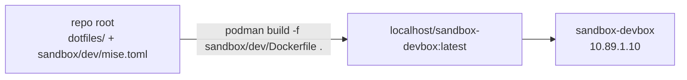

# dev — the devbox Dockerfile

This folder holds the Dockerfile for `sandbox-devbox`, the environment an agent
works in, plus `mise.toml`, that image's own config. The dotfile **sources**
are not copied here — they live in the repo's `dotfiles/` folder.

## Build context: the repo root

The image builds from the repository root, not from this folder:



The Dockerfile's two `COPY`s take `dotfiles/` (the single folder holding every
config source) and `sandbox/dev/mise.toml` (the container's config), placing
them at the checkout root inside the image — `mise.toml` with the sources under
`dotfiles/`, mirroring the repo. There `mise trust && mise install && mise dot
apply` runs. Because nothing is mirrored, an edit to a dotfile is picked up by
the next build with no sync step, and the image still contains no `docs/`, no
`.git`, and none of the rest of the sandbox.

## Building it

```sh
bin/sandbox build                                             # compose build (context = repo root)
podman build -f sandbox/dev/Dockerfile -t worktainer .        # standalone, from the repo root
```

## Editing the config

Add tools and dotfiles to `dotfiles/` (the sources) and list them in
`sandbox/dev/mise.toml` here — that file is the only thing the image deploys
from. A fresh machine uses the repo-root `mise.toml` instead.

> Run mise commands from the **repo root**, not from this folder. `mise.toml`
> here is written for the image checkout (where it sits at the root with
> `dotfiles/` beside it); invoked from `sandbox/dev/` on the host its sources
> would resolve against the wrong directory.
