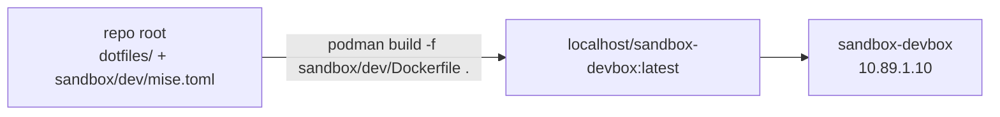

# dev — the devbox Dockerfile

This folder holds the Dockerfile for `sandbox-devbox`, the environment an agent
works in, plus `mise.toml`, that image's own config. The dotfile **sources**
are not copied here — they live in the repo's `dotfiles/` folder.

## Build context: the repo root

The image builds from the repository root, not from this folder:



The Dockerfile's two `COPY`s take `dotfiles/` (the single folder holding every
config source) and `sandbox/dev/mise.toml` (the container's config), placing
them at the checkout root inside the image — `mise.toml` with the sources under
`dotfiles/`, mirroring the repo. There `mise trust && mise install && mise dot
apply` runs. Because nothing is mirrored, an edit to a dotfile is picked up by
the next build with no sync step, and the image still contains no `docs/`, no
`.git`, and none of the rest of the sandbox.

## Building it

```sh
bin/sandbox build                                             # compose build (context = repo root)
podman build -f sandbox/dev/Dockerfile -t worktainer .        # standalone, from the repo root
```

## SSH into the devbox

The image ships an sshd; **who can log in is decided by OpenBao**, not by the
image. Nothing needs root at runtime, so `ssh -p 2222 dev@127.0.0.1` works as
soon as the stack is up and a key has been stored:

| Piece | Where | Why there |
| ----- | ----- | --------- |
| sshd binary | `openssh-server` in the Dockerfile's apt list | the only sshd piece that needs the root side of the image build |
| sshd config | [`dotfiles/sshd/sshd_config`](../../dotfiles/sshd/sshd_config), deployed by `[dotfiles]` in [`mise.toml`](./mise.toml) to `~/.ssh/sshd/sshd_config` | an unprivileged sshd may not touch `/etc/ssh` |
| host key | generated in the Dockerfile, `~/.ssh/sshd/ssh_host_ed25519_key` | same: `/etc/ssh/ssh_host_*` is off limits |
| authorized keys | **OpenBao**, `secret/devbox/authorized_keys` | keys change without a rebuild: edit the secret, restart the devbox |
| port | `2222` (set in the config) | the unprivileged `dev` user cannot bind 22; it is what the ingress DNATs the host port to |

`sshd-init` (baked to `/usr/local/bin`) pulls `authorized_keys` out of the
secret into `~/.ssh/authorized_keys` before sshd starts, and compose runs the
sshd in the foreground, so failed logins show up in `bin/sandbox logs devbox`.
`bin/sandbox check` verifies the listener and reports whether any keys were
provisioned.

Store your public keys in the secret (one per line). From inside the devbox
the `bao` CLI is in the image already:

```sh
bin/sandbox shell devbox
export BAO_TOKEN=sandbox-root-token          # set in compose.yaml
bao kv put secret/devbox/authorized_keys \
    authorized_keys=@"$HOME/.ssh/id_ed25519.pub"
exit
```

or with an editor/UI: <http://127.0.0.1:8200> (root token also in
compose.yaml).

New keys take effect on the next devbox restart; to apply them without one:

```sh
bin/sandbox exec devbox sshd-init
```

(the sshd reads `authorized_keys` per login, so no daemon reload is needed.)

A build that re-runs the host-key layer — in practice, every build after a
dotfile edit — bakes a new host key: expect the client to complain about a
changed fingerprint and drop the stale `[127.0.0.1]:2222` line from your
`~/.ssh/known_hosts`. The sshd itself never allows passwords: as `dev` there
is no root to read `/etc/shadow`, and PAM is off — the config is
[`dotfiles/sshd/sshd_config`](../../dotfiles/sshd/sshd_config).

## Editing the config

Add tools and dotfiles to `dotfiles/` (the sources) and list them in
`sandbox/dev/mise.toml` here — that file is the only thing the image deploys
from. A fresh machine uses the repo-root `mise.toml` instead.

> Run mise commands from the **repo root**, not from this folder. `mise.toml`
> here is written for the image checkout (where it sits at the root with
> `dotfiles/` beside it); invoked from `sandbox/dev/` on the host its sources
> would resolve against the wrong directory.
