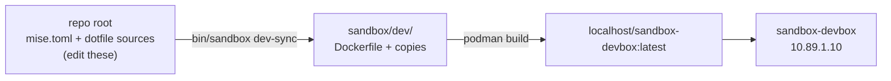

# dev — the devbox build context

This folder is the build context for `sandbox-devbox`: the environment an
agent works in. It holds the Dockerfile **and a copy of this repo's dotfile
sources** — `mise.toml`, `bashrc`, `bat/`, `yazi/`, and the rest.

## The copy

The originals live at the repo root and are the ones to edit. This folder is a
mirror, refreshed by:

```sh
bin/sandbox dev-sync      # also runs automatically before build and up
```

`dev-sync` copies the sources listed in `bin/sandbox`, then removes anything
here that no longer exists at the root, so the build context never keeps a
dotfile the repo has dropped.



Because the context is this folder and not the repo root, the image contains
only what the devbox needs: no `docs/`, no `.git`, and none of the rest of the
sandbox. The Dockerfile's `COPY --chown=dev:dev . .` sees exactly these files.

## Building it

```sh
bin/sandbox build                                  # dev-sync + compose build
podman build -t worktainer sandbox/dev             # standalone, same thing
```

## Editing a dotfile

Edit the file at the **repo root**, then re-sync. Editing a file in here works
too, but the next `dev-sync` overwrites it — the root is the source of truth.
