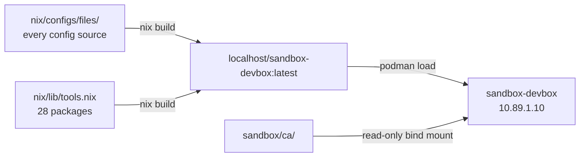

# dev — the devbox image

This folder holds the boot helpers for `sandbox-devbox`, the environment an
agent works in. The image itself is defined in
[`nix/images/devbox.nix`](../../nix/images/devbox.nix) and started by
[`sandbox/quadlet/sandbox-devbox.container`](../quadlet/sandbox-devbox.container).



Two scripts here:

| Script | Runs | What it does |
| ------ | ---- | ------------ |
| [`devbox-init.sh`](./devbox-init.sh) | container start, in `/usr/local/bin` | appends the mounted sandbox CA to the trust store, then hands over to the two below |
| [`sshd-init.sh`](./sshd-init.sh) | from `devbox-init` | pulls `authorized_keys` out of OpenBao |

## Building it

```sh
bin/sandbox build                      # nix build .#sandbox-devbox, then podman load
nix build .#sandbox-devbox             # the tarball alone, no load
```

Nothing is copied in from a build context: the config is read from
`nix/configs/files/`, the tools from `nix/lib/tools.nix`, and both land in the
image through the nix store. An edit to a config source is picked up by the next
build, and the image contains no `docs/`, no `.git` and none of the rest of the
sandbox.

## The CA it trusts

The sandbox CA — what the egress's proxy signs the TLS it intercepts with, so
the devbox can inspect outbound `https://`. See
[`../egress/README.md`](../egress/README.md) for what that buys and what it
costs.

It is **not baked into the image**. `sandbox/ca/` is generated per machine and
gitignored, so the flake that builds the image cannot see it at all — and
naming it would put the *private key* into the nix store, and the store into the
image. Instead:

1. `bin/sandbox ca` writes the pair (both `build` and `up` call it).
2. The unit bind-mounts the folder read-only at `/etc/sandbox/ca`.
3. `devbox-init` appends the certificate to
   `/etc/ssl/certs/ca-certificates.crt` on every container start.

So rotating the CA is `bin/sandbox ca` (after deleting the old pair) and a
**devbox restart** — not a rebuild — and the private key never leaves the host's
`~/.local/share/containers` side of the boundary.

Node and Python are pointed at the system bundle explicitly
(`NODE_EXTRA_CA_CERTS`, `REQUESTS_CA_BUNDLE`, set by the image): neither reads
the system trust store on its own.

## SSH into the devbox

The image ships an sshd; **who can log in is decided by OpenBao**, not by the
image. Nothing needs root at runtime, so `ssh -p 2222 dev@127.0.0.1` works as
soon as the stack is up and a key has been stored:

| Piece | Where | Why there |
| ----- | ----- | --------- |
| sshd binary | `pkgs.openssh` in `nix/images/devbox.nix` | the only sshd piece that needs the build |
| sshd config | [`nix/configs/files/sshd/sshd_config`](../../nix/configs/files/sshd/sshd_config), deployed to `~/.ssh/sshd/sshd_config` by `nix/lib/deploy.nix` | an unprivileged sshd may not touch `/etc/ssh` |
| host key | generated by the image build, `~/.ssh/sshd/ssh_host_ed25519_key` | same: `/etc/ssh/ssh_host_*` is off limits |
| authorized keys | **OpenBao**, `secret/devbox/authorized_keys` | keys change without a rebuild: edit the secret, restart the devbox |
| the token to read them | `/vault/devbox.token`, from a shared volume | scoped to that one path and to `read`; the root token is not in this container at all (audit S1) |
| port | `2222` (set in the config) | the unprivileged `dev` user cannot bind 22; it is what the ingress DNATs the host port to |

`sshd-init` pulls `authorized_keys` out of the secret into
`~/.ssh/authorized_keys` before sshd starts, and the unit runs sshd in the
foreground, so failed logins show up in `bin/sandbox logs devbox`.
`bin/sandbox check` verifies the listener and reports whether any keys were
provisioned.

Store your public keys in the secret (one per line). From inside the devbox
the `bao` CLI is in the image already:

```sh
bin/sandbox shell devbox
# The devbox's own token: read on authorized_keys and nothing else.
export BAO_TOKEN=$(cat /vault/devbox.token)
bao kv put secret/devbox/authorized_keys \
    authorized_keys=@"$HOME/.ssh/id_ed25519.pub"
exit
```

That `bao kv put` will be refused with 403, and that is correct: the devbox's
token is scoped to *read* on its one secret, because an agent with code
execution in this container shares it (audit S1). Store keys from the host, with
the recipe in [`../openbao/README.md`](../openbao/README.md), and the devbox
picks them up on its next boot.

or with an editor/UI: <http://127.0.0.1:8200> (root token in
[`environments/openbao.env`](../quadlet/environments/openbao.env)).

New keys take effect on the next devbox restart; to apply them without one:

```sh
bin/sandbox exec devbox sshd-init
```

(the sshd reads `authorized_keys` per login, so no daemon reload is needed.)

A rebuild bakes a new host key: expect the client to complain about a changed
fingerprint and drop the stale `[127.0.0.1]:2222` line from your
`~/.ssh/known_hosts`. The sshd itself never allows passwords: as `dev` there
is no root to read `/etc/shadow`, and PAM is off — the config is
[`sshd_config`](../../nix/configs/files/sshd/sshd_config).

## Talking out through the proxy

Everything the devbox sends to the internet leaves through the egress. For
`https` that includes the auth-injecting proxy: the devbox trusts the sandbox CA
(above), so the egress can read what it sends and put an API key on it that the
devbox never holds. Nothing to configure here — but two things are worth
knowing:

- **The key is never in the devbox.** If the agent asks for an API key, it does
  not get one; the proxy adds it on the way out. See
  [`../egress/README.md`](../egress/README.md) for which hosts get which
  headers, and how to add a provider.
- **Tools that ignore the system trust store need pointing at it.** Node ships
  its own root list and Python's `requests` uses certifi, so the image sets
  `NODE_EXTRA_CA_CERTS` and `REQUESTS_CA_BUNDLE` for the whole container. A tool
  that does something else again (a bundled Go root set, a JVM truststore) needs
  the same treatment, or it will refuse every intercepted call.

To route one command through the proxy explicitly — useful when debugging, and
for traffic the redirect does not cover:

```sh
bin/sandbox exec devbox env HTTPS_PROXY=http://10.89.1.2:8080 curl -sSv https://api.openai.com/v1/models
```

## Editing the config

Add a source under `nix/configs/files/`, list it in
[`nix/configs/default.nix`](../../nix/configs/default.nix), and say where it
goes in [`nix/lib/deploy.nix`](../../nix/lib/deploy.nix). That last file is the
same table for the host and for this image, which is why a tool added once is
deployed in both places.

Tools go in [`nix/lib/tools.nix`](../../nix/lib/tools.nix) — as an attribute,
not a name, because five of them are not under the name mise gave them. See
[`nix/README.md`](../../nix/README.md).

> The devbox installs its packages through `environment.systemPackages`-style
> list in `nix/images/devbox.nix` rather than through a profile, so it does not
> carry mise, or nix itself, into the image.