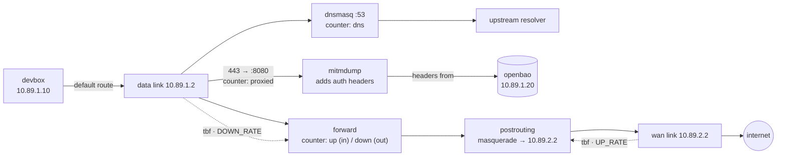
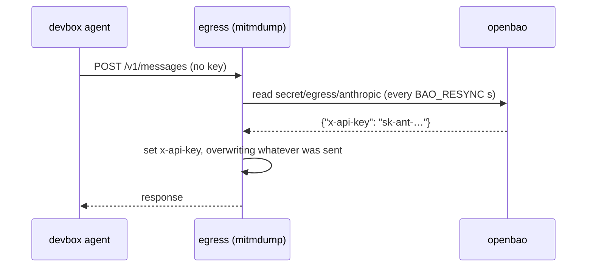

# Egress controller

The only way out of the sandbox. It is the devbox's default gateway: it
masquerades everything it forwards onto the WAN, answers the devbox's DNS with
dnsmasq, shapes both of its links, counts upload, download and DNS, and — when
`HEADER_JOBS` names a secret — decrypts the devbox's outbound `https` to inject
auth headers whose values live in OpenBao, never in the devbox.

## What it does



1. **Locate interfaces by address** — `10.89.0.2`, `10.89.1.2`, `10.89.2.2`.
2. **Fix the routes.** The data network installs `default via 10.89.1.2` in
   every member, including this container — a route to itself. Delete it and
   keep the WAN default (metric `100` beats the data route's `1000`).
3. **Start dnsmasq** on the data interface only.
4. **Start the auth proxy** (when armed) and wait for it to listen.
5. **Install the ruleset**: counters, the redirect to the proxy, and a
   masquerade on the WAN.
6. **Shape** both links, then **export** the counters as OTel spans.

## Route handling

```sh
bin/sandbox exec egress ip route show default
```

Expected: one default via `10.89.2.1` (the WAN gateway), and **no** default via
`10.89.1.2`. If you see `default via 10.89.1.2`, the entrypoint has not run
yet or the data network's route won the tie — see
[Caveats](../README.md#caveats).

## Ruleset

Print what it would install, with no container needed:

```sh
bin/sandbox rules egress
```

```nft
table inet egress {
    counter up {}
    counter down {}
    counter dns {}

    chain dns_queries {
        type filter hook input priority filter; policy accept;
        iifname "eth1" udp dport 53 counter name dns
        iifname "eth1" tcp dport 53 counter name dns
    }

    chain forward {
        type filter hook forward priority filter; policy accept;
        iifname "eth1" counter name up
        oifname "eth1" counter name down
    }

    chain prerouting {
        type nat hook prerouting priority dstnat; policy accept;
        ip saddr 10.89.1.10 ip daddr != 10.89.0.0/16 tcp dport 443 counter name proxied redirect to :8080
    }

    chain postrouting {
        type nat hook postrouting priority srcnat; policy accept;
        oifname "eth2" masquerade
    }
}
```

`up` counts what arrives from the devbox, `down` what is sent back to it; the
two conditions are mutually exclusive for any forwarded packet, so nothing is
double counted.

`proxied` is counted in `prerouting`, so it sees **requests only** — the bytes
of a reply are counted by `down` on the way back, not again here. It also only
exists when the proxy is armed; with an empty `HEADER_JOBS` there is no
`prerouting` chain at all.

The masquerade is what makes the reply work at all: the internet replies to
`10.89.2.2`, which is this container, and conntrack then rewrites the
destination back to `10.89.1.10` and sends it out the data link.

## DNS

dnsmasq listens on the data interface only and forwards upstream. The devbox's
`resolv.conf` points at `10.89.1.2`, so lookups are subject to the same
boundary, counters and shaping as everything else.

- config: [`dnsmasq.conf`](./dnsmasq.conf) — `no-resolv`, `no-hosts`, small cache;
- upstream: `--server="$DNS_UPSTREAM"` on the command line;
- bind: `--interface=<data interface> --bind-interfaces`.

Queries are logged with `--log-queries` only if you add it by hand
(`bin/sandbox exec egress dnsmasq …`) — it is too noisy to leave on.

## Auth injection

The devbox's agent has an LLM provider's API endpoint and no key for it. The key
lives in [OpenBao](../openbao/) and this container puts it on the wire:



That buys three things: the key never enters the devbox (so a prompt-injected
agent cannot read it out of its own environment or a request), the agent cannot
forge one (the header is always overwritten), and rotating the key is a secret
edit rather than a rebuild.

**It costs a TLS interception.** The devbox has to trust a certificate this
container mints — that is what [`bin/sandbox ca`](../ca/README.md) is for — and
so does any tool inside the devbox that does not read the system trust store
(Node ships its own root list; Python's `requests` uses certifi), which is why
compose points `NODE_EXTRA_CA_CERTS` and `REQUESTS_CA_BUNDLE` at the system
bundle. Everything the devbox fetches is readable here, in plain text, and the
devbox's `bin/sandbox check` cannot tell the difference between a real provider
and this proxy. That is the deal: the sandbox is where you point an agent you
are willing to watch.

### Wiring it up

`HEADER_JOBS` is one job per line:

```
<host> bao:<mount>/<path>
```

The host matches itself and anything under it (`api.example.com` also matches
`eu.api.example.com`, not `notexample.com`). The secret is a KV v2 entry whose
**field names are the header names**:

```sh
# from the host: give one provider a key
curl -sS -X POST http://127.0.0.1:8200/v1/secret/data/egress/anthropic \
    -H 'X-Vault-Token: sandbox-root-token' \
    -d '{"data":{"x-api-key":"sk-ant-..."}}'

# …or, from the devbox, where the bao CLI already is
bin/sandbox shell devbox
bao kv put secret/egress/anthropic x-api-key="$KEY"
```

`compose.yaml` ships two jobs (`api.anthropic.com`, `api.openai.com`) pointing
at secrets that may not exist yet — a job with no secret yet simply injects
nothing, and the provider answers 401. Change the hosts in `compose.yaml` to
match whatever you actually call.

### Rotation and failure

- **Rotating a key** takes effect within `BAO_RESYNC` seconds (default 300; `0`
  reads once at boot). No restart, no rebuild — the addon re-reads in a
  background thread, never on the request path.
- **Emptying a secret strips its headers.** Once the addon has seen a secret, it
  remembers the header names; if the secret later reads empty, those headers are
  removed from the request instead of being left to whatever the agent sent.
- **A secrets blip changes nothing.** A failed read logs a warning and the
  previous headers stay in place; requests never wait on OpenBao.
- **A missing secret is a 401, not a crash** — including at boot, when the
  devbox and this container may start before OpenBao is listening. The addon
  simply retries on the next resync.
- **A malformed `HEADER_JOBS` line** is dropped with a warning; the other jobs
  keep working. It is not worth taking DNS and masquerading down over a typo.

### The CA

The proxy signs what it presents with the sandbox CA (staged from the read-only
`/etc/sandbox/ca` mount into mitmproxy's confdir on boot, as
`mitmproxy-ca.pem`). If the CA is missing, mitmproxy mints its own — and then
every `https` call from the devbox fails with a certificate error until the
devbox is rebuilt against the real one:

```sh
bin/sandbox ca && bin/sandbox build
```

## Configuring it later

All of it is a secret plus compose environment. **No rebuild is involved**: the
devbox neither holds the keys nor compiles the job list, and the CA it trusts is
already baked in.

### Add a provider

1. Store the secret — the field name *is* the header name, and several fields in
   one secret become several headers on the same request:

   ```sh
   curl -sS -X POST http://127.0.0.1:8200/v1/secret/data/egress/<provider> \
       -H 'X-Vault-Token: sandbox-root-token' \
       -d '{"data":{"x-api-key":"…","x-org-id":"…"}}'
   ```

2. Add a line to `HEADER_JOBS` in `compose.yaml`:

   ```
   api.<provider>.com bao:secret/egress/<provider>
   ```

3. `bin/sandbox up` (or `podman restart sandbox-egress`). The addon logs
   `<host>: <headers> from /v1/secret/data/…` once it has read it.

### Change what gets intercepted

| Env | Default | Effect |
| --- | ------- | ------ |
| `DEVBOX_IP` | `10.89.1.10` | whose outbound 443 is redirected |
| `SANDBOX_NETS` | `10.89.0.0/16` | never intercepted — keep OpenBao (and any other service you add on `10.89.x.x`) inside it |
| `PROXY_PORT` | `8080` | mitmdump's port *and* the redirect target; changing it needs no other file |

A host outside the sandbox's address space (`192.0.2.7:8443`) is not matched by
any `HEADER_JOBS` line, so it is decrypted, forwarded, and left alone — the
interception is not a filter, only the injection is selective.

### Turn interception off

Empty `HEADER_JOBS` in `compose.yaml`: the `prerouting` chain and the `proxied`
counter are not installed, the devbox's `https` goes out untouched, and the CA
sits unused. (The devbox keeps trusting it — harmless, and it means turning it
back on needs no rebuild.)

### Point one tool at the proxy explicitly

For traffic the redirect does not cover, or to debug a single request:

```sh
bin/sandbox exec devbox env HTTPS_PROXY=http://10.89.1.2:8080 \
    curl -sSv https://api.openai.com/v1/models
```

`NO_PROXY` should cover sandbox-internal addresses (`NO_PROXY=10.89.1.20`
for OpenBao) so those do not detour through the proxy.

### Check it is doing something

```sh
bin/sandbox logs egress | grep 'from /v1/secret'   # the secrets it has read
bin/sandbox exec egress nft list counters          # is `proxied` climbing?
```

From the devbox, a provider answering **401** means no header got through (the
secret is empty, or the host pattern does not match); anything else means one
did. `bin/sandbox check` covers the wiring itself — proxy running, counter
declared, redirect installed, devbox trusting the CA.

## Environment variables

Defaults live in `entrypoint.sh` and mirror `compose.yaml`.

| Variable | Default | Meaning |
| -------- | ------- | ------- |
| `CTRL_IP` / `DATA_IP` / `WAN_IP` | `10.89.0.2` / `.1.2` / `.2.2` | used to find the interfaces |
| `WAN_GW` | `10.89.2.1` | used only if no default route exists at all |
| `UP_RATE` | `100mbit` | tbf on the WAN link (upload) |
| `DOWN_RATE` | `100mbit` | tbf on the data link (download) |
| `DELAY` / `LOSS` | `0ms` / `0%` | netem on both links |
| `BURST` / `LATENCY` | `64kbit` / `400ms` | tbf burst and latency |
| `DNS_UPSTREAM` | `9.9.9.9` | resolver dnsmasq forwards to |
| `HEADER_JOBS` | two providers in compose | `"<host> bao:<mount>/<path>"` lines; empty disables the proxy entirely |
| `BAO_ADDR` / `BAO_TOKEN` | `http://10.89.1.20:8200` / `sandbox-root-token` | where the header values come from |
| `BAO_RESYNC` | `300` | seconds between secret re-reads; `0` reads once at boot |
| `PROXY_PORT` | `8080` | mitmdump's listen port, and the redirect target |
| `PROXY_CONF_DIR` | `/var/lib/mitmproxy` | where the staged CA lives |
| `CA_DIR` | `/etc/sandbox/ca` | the read-only mount holding `sandbox-ca.{key,crt}` |
| `DEVBOX_IP` | `10.89.1.10` | whose outbound 443 is intercepted |
| `SANDBOX_NETS` | `10.89.0.0/16` | sandbox-internal space, never intercepted (so OpenBao's own traffic is not) |
| `MITM_VERBOSITY` | `info` | mitmdump log level; `warn` hides the per-request lines |
| `OTEL_SERVICE_NAME` | `sandbox-egress` | `service.name` on exported spans |
| `OTEL_ENDPOINTS` | three backends | OTLP/HTTP traces URLs, space separated |
| `METRICS_INTERVAL` | `15` | seconds between `net.counters` spans |
| `DRY_RUN` | unset | set to `1` to print the ruleset and exit |

## Inspecting it

```sh
bin/sandbox nft egress                       # live ruleset
bin/sandbox exec egress nft list counters    # up / down / dns / proxied in bytes
bin/sandbox exec egress tc qdisc show
bin/sandbox logs egress
```

mitmdump logs every request it proxies at `info`, which is a firehose for a busy
devbox and a decent audit trail for a quiet one — `MITM_VERBOSITY=warn` trades
the traffic for the addon's warnings about the secrets themselves.

## Troubleshooting

| Symptom | Cause | Fix |
| ------- | ----- | --- |
| every `https` call from the devbox fails with a certificate error | the devbox image does not have the sandbox CA (proxy minted its own) | `bin/sandbox ca && bin/sandbox build` |
| `curl: (7) CONNECT tunnel failed, response 502` | the redirect is installed but nothing is listening | the proxy died; it exits the container on purpose so the restart policy brings it back — read `bin/sandbox logs egress` |
| provider answers 401 | the job matches but the secret is empty, missing, or under a different host | `bao kv get secret/egress/<provider>`; check `HEADER_JOBS` |
| `check` SKIPs the `proxied` counter | `HEADER_JOBS` is empty, so nothing is intercepted | set at least one job in `compose.yaml` |

## Caveats

- **It is a router, so it needs `ip_forward`.** Set both by compose and again
  in the entrypoint, because the order in which podman applies sysctls and
  creates interfaces is not something to rely on.
- **`rp_filter` must be off.** Inbound and outbound traffic use different
  interfaces; a strict reverse-path check would drop legitimate packets.
- **The data route points at it.** Every member of the data network gets the
  route, this container included. Deleting its copy is the first thing the
  entrypoint does after locating the interfaces.
- **The proxy is a TLS man-in-the-middle.** Everything the devbox fetches
  passes through it in plain text, and the devbox is built to trust it. Point a
  real credential at this sandbox and you have handed it over.
- **Only TCP 443 is redirected.** Plain `http://`, other ports and **UDP/443
  (QUIC)** go straight out: nothing is intercepted and no header is injected, so
  a client that insists on HTTP/3 fails against a 401 rather than being quietly
  broken. Most tooling (curl, Node's fetch) does not negotiate QUIC.
- **mitmdump listens on `0.0.0.0:$PROXY_PORT`**, so anything that can reach this
  container may use it as a proxy. Only the devbox is on the data network, and
  using the proxy gives it nothing it does not already have.
- **If the proxy dies, the redirect stays.** That is deliberate — failing closed
  beats silently letting traffic past a proxy that cannot inject anything — and
  the entrypoint exits so the restart policy brings the whole egress back.
