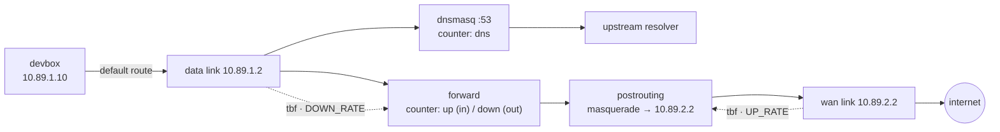

# Egress controller

The only way out of the sandbox. It is the devbox's default gateway: it
masquerades everything it forwards onto the WAN, answers the devbox's DNS with
dnsmasq, shapes both of its links, and counts upload, download and DNS.

## What it does



1. **Locate interfaces by address** — `10.89.0.2`, `10.89.1.2`, `10.89.2.2`.
2. **Fix the routes.** The data network installs `default via 10.89.1.2` in
   every member, including this container — a route to itself. Delete it and
   keep the WAN default (metric `100` beats the data route's `1000`).
3. **Start dnsmasq** on the data interface only.
4. **Install the ruleset**: counters plus a masquerade on the WAN.
5. **Shape** both links, then **export** the counters as OTel spans.

## Route handling

```sh
bin/sandbox exec egress ip route show default
```

Expected: one default via `10.89.2.1` (the WAN gateway), and **no** default via
`10.89.1.2`. If you see `default via 10.89.1.2`, the entrypoint has not run
yet or the data network's route won the tie — see
[Caveats](../README.md#caveats).

## Ruleset

Print what it would install, with no container needed:

```sh
bin/sandbox rules egress
```

```nft
table inet egress {
    counter up {}
    counter down {}
    counter dns {}

    chain dns_queries {
        type filter hook input priority filter; policy accept;
        iifname "eth1" udp dport 53 counter name dns
        iifname "eth1" tcp dport 53 counter name dns
    }

    chain forward {
        type filter hook forward priority filter; policy accept;
        iifname "eth1" counter name up
        oifname "eth1" counter name down
    }

    chain postrouting {
        type nat hook postrouting priority srcnat; policy accept;
        oifname "eth2" masquerade
    }
}
```

`up` counts what arrives from the devbox, `down` what is sent back to it; the
two conditions are mutually exclusive for any forwarded packet, so nothing is
double counted.

The masquerade is what makes the reply work at all: the internet replies to
`10.89.2.2`, which is this container, and conntrack then rewrites the
destination back to `10.89.1.10` and sends it out the data link.

## DNS

dnsmasq listens on the data interface only and forwards upstream. The devbox's
`resolv.conf` points at `10.89.1.2`, so lookups are subject to the same
boundary, counters and shaping as everything else.

- config: [`dnsmasq.conf`](./dnsmasq.conf) — `no-resolv`, `no-hosts`, small cache;
- upstream: `--server="$DNS_UPSTREAM"` on the command line;
- bind: `--interface=<data interface> --bind-interfaces`.

Queries are logged with `--log-queries` only if you add it by hand
(`bin/sandbox exec egress dnsmasq …`) — it is too noisy to leave on.

## Environment variables

Defaults live in `entrypoint.sh` and mirror `compose.yaml`.

| Variable | Default | Meaning |
| -------- | ------- | ------- |
| `CTRL_IP` / `DATA_IP` / `WAN_IP` | `10.89.0.2` / `.1.2` / `.2.2` | used to find the interfaces |
| `WAN_GW` | `10.89.2.1` | used only if no default route exists at all |
| `UP_RATE` | `100mbit` | tbf on the WAN link (upload) |
| `DOWN_RATE` | `100mbit` | tbf on the data link (download) |
| `DELAY` / `LOSS` | `0ms` / `0%` | netem on both links |
| `BURST` / `LATENCY` | `64kbit` / `400ms` | tbf burst and latency |
| `DNS_UPSTREAM` | `9.9.9.9` | resolver dnsmasq forwards to |
| `OTEL_SERVICE_NAME` | `sandbox-egress` | `service.name` on exported spans |
| `OTEL_ENDPOINTS` | three backends | OTLP/HTTP traces URLs, space separated |
| `METRICS_INTERVAL` | `15` | seconds between `net.counters` spans |
| `DRY_RUN` | unset | set to `1` to print the ruleset and exit |

## Inspecting it

```sh
bin/sandbox nft egress                       # live ruleset
bin/sandbox exec egress nft list counters    # up / down / dns in bytes
bin/sandbox exec egress tc qdisc show
bin/sandbox logs egress
```

## Caveats

- **It is a router, so it needs `ip_forward`.** Set both by compose and again
  in the entrypoint, because the order in which podman applies sysctls and
  creates interfaces is not something to rely on.
- **`rp_filter` must be off.** Inbound and outbound traffic use different
  interfaces; a strict reverse-path check would drop legitimate packets.
- **The data route points at it.** Every member of the data network gets the
  route, this container included. Deleting its copy is the first thing the
  entrypoint does after locating the interfaces.
