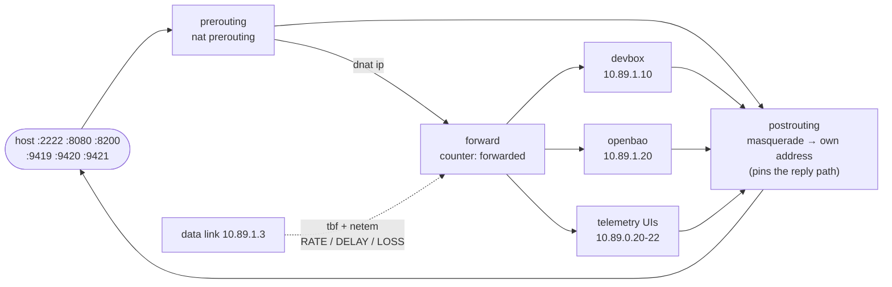

# Ingress controller

The only way into the sandbox from the host. It terminates the published host
ports, rewrites each one to a backend on the data or control network, shapes
the link towards the devbox, and counts what it forwards.

## What it does



1. **Locate interfaces by address.** podman does not promise an order when a
   container joins several networks, so the entrypoint finds the interface
   holding `10.89.0.3` and `10.89.1.3` instead of assuming `eth0`/`eth1`.
2. **Enable forwarding.** `ip_forward=1`, `rp_filter=0` — packets arrive on one
   interface and leave by another.
3. **Build and install the ruleset** from `FORWARDS`.
4. **Shape** the devbox-facing link with tbf (rate) and netem (delay/loss).
5. **Export** the counters as OTel spans on an interval.

## Ruleset

Print exactly what it would install, with no container needed:

```sh
bin/sandbox rules ingress
```

That renders (ports come from `FORWARDS`):

```nft
table inet ingress {
    counter forwarded {}

    chain prerouting {
        type nat hook prerouting priority dstnat; policy accept;
        tcp dport 9420 counter dnat ip to 10.89.0.21:8000
        udp dport 9420 counter dnat ip to 10.89.0.21:8000
        # …one pair per entry in FORWARDS
    }

    chain forward {
        type filter hook forward priority filter; policy accept;
        counter name forwarded
    }

    chain postrouting {
        type nat hook postrouting priority srcnat; policy accept;
        masquerade
    }
}
```

`dnat ip to` rather than plain `dnat to`: an `inet` table holds both address
families, so nftables wants the family spelled out.

The postrouting masquerade is load-bearing. The backends are on the same
networks as the host's port proxy, so without it a backend's reply would leave
over the bridge toward the proxy's source address, bypass the controller, and
never have the DNAT undone — the proxy would reject it as a reply from the
wrong address. Masquerading to this container's own address forces the reply
to come back here.

## Environment variables

Defaults live in `entrypoint.sh` and mirror [`environments/ingress.env`](../quadlet/environments/ingress.env),
which is what the container actually reads and where you
should edit them.

| Variable | Default | Meaning |
| -------- | ------- | ------- |
| `CTRL_IP` | `10.89.0.3` | this container's control-plane address, used to find the interface |
| `DATA_IP` | `10.89.1.3` | its data-plane address |
| `FORWARDS` | 5 entries | `host-port:target-ip:target-port`, space separated |
| `RATE` | `100mbit` | tbf rate on the devbox-facing link; empty disables shaping |
| `DELAY` | `0ms` | netem delay |
| `LOSS` | `0%` | netem loss |
| `BURST` | `64kbit` | tbf burst |
| `LATENCY` | `400ms` | tbf latency |
| `OTEL_SERVICE_NAME` | `sandbox-ingress` | `service.name` on exported spans |
| `OTEL_ENDPOINTS` | three backends | OTLP/HTTP traces URLs, space separated |
| `METRICS_INTERVAL` | `15` | seconds between `net.counters` spans |
| `DRY_RUN` | unset | set to `1` to print the ruleset and exit |

## Inspecting it

```sh
bin/sandbox nft ingress          # live ruleset
bin/sandbox exec ingress tc qdisc show
bin/sandbox logs ingress
bin/sandbox rules ingress        # what it would install (works without podman)
```

Counters, live:

```sh
podman exec sandbox-ingress nft list counters
```

## Adding a forward

Add one line to `FORWARDS` in [`environments/ingress.env`](../quadlet/environments/ingress.env)
and a matching port under
`ports:`, then `bin/sandbox up`. The host port and the container port are the
same number in this setup, but they do not have to be — the rule is rewritten
from the entry itself.

## Caveats

- **Published ports land on this container.** Rootless podman's port proxy
  connects to one of this container's addresses; the rules match on the port
  alone, so it works whichever address it picked.
- **No egress shaping here.** Anything leaving the sandbox is shaped by the
  egress controller, not this one.
- **The sshd ships in the devbox.** Port 2222 reaches it with nothing to
  start: the image bakes an sshd listening on 2222 inside the devbox (which
  is why the forward targets that port — an unprivileged sshd cannot bind
  22). Its authorized keys are served by OpenBao, not baked into the image;
  until a key is stored in `secret/devbox/authorized_keys` every login is
  refused. See [`dev/README.md`](../dev/README.md).
