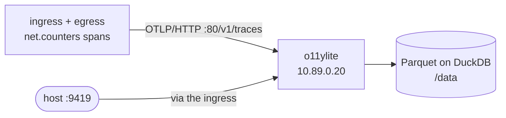

# Telemetry backend: o11ylite

[o11ylite](https://github.com/o11ylite/o11ylite) — a whole OpenTelemetry
backend in one process: OTLP receiver, DuckDB/DuckLake storage and a web UI.



## In the sandbox

| | |
| --- | --- |
| Image | `ghcr.io/o11ylite/o11ylite:latest` |
| Address | `10.89.0.20` on `sandbox-ctrl` |
| OTLP (traces, logs, metrics) | `http://10.89.0.20/v1/traces` (also `/v1/logs`, `/v1/metrics`), OTLP/gRPC on `10.89.0.20:80` |
| Web UI | container port `80`, reached from the host as **<http://127.0.0.1:9419>** through the ingress |
| Storage | named volume `o11ylite-data` at `/data` (`O11YLITE_DATA_PATH=/data`) |

One port serves both ingestion and the UI: a built-in proxy routes OTLP/gRPC,
OTLP/HTTP and the browser on `:80`. Nothing about the sandbox has to change to
point a new emitter at it — just aim the exporter at `10.89.0.20:80`.

## Pointing something at it

```sh
export OTEL_EXPORTER_OTLP_ENDPOINT="http://10.89.0.20:80"
export OTEL_EXPORTER_OTLP_PROTOCOL="http/protobuf"
export OTEL_TRACES_EXPORTER="otlp"
```

The controllers already do this by default (`OTEL_ENDPOINTS` in
`compose.yaml`). A quick manual check from a controller:

```sh
bin/sandbox exec ingress curl -sS -o /dev/null -w '%{http_code}\n' \
  -X POST -H 'content-type: application/json' \
  http://10.89.0.20/v1/traces -d '{}'
```

## Why it earns its place

- **Everything on one port.** No split between an ingest listener and a query
  listener to keep in sync.
- **Open storage.** Parquet files handled through DuckDB and DuckLake, so the
  data is queryable with plain SQL and does not need an indexer fleet.
- **Traces, logs and metrics all in one store**, which matters when the metric
  is a span attribute (the counters here are spans, so a backend that only
  understands traces is fine, but a backend that also takes metrics is not
  wasted).

## Trade-offs

- **The image is large** (~520 MB — it ships a JVM).
- **One port means one thing to firewall**, but also that a UI outage and an
  ingest outage are the same outage.
- **AGPL.** Worth knowing before you build anything hosted on top of it.

## Inspecting it

```sh
bin/sandbox logs telemetry-o11ylite
podman volume inspect sandbox_o11ylite-data    # the project name prefixes it
```
