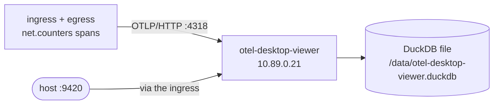

# Telemetry backend: otel-desktop-viewer

[otel-desktop-viewer](https://github.com/CtrlSpice/otel-desktop-viewer) — a
small OpenTelemetry Collector build with a `desktop` exporter: it stores
whatever arrives in DuckDB and serves one page that shows it.



## In the sandbox

| | |
| --- | --- |
| Image | `ghcr.io/ctrlspice/otel-desktop-viewer:latest` |
| Address | `10.89.0.21` on `sandbox-ctrl` |
| OTLP HTTP | `http://10.89.0.21:4318/v1/traces` (also `/v1/logs`, `/v1/metrics`) |
| OTLP gRPC | `10.89.0.21:4317` |
| Web UI | container port `8000`, reached from the host as **<http://127.0.0.1:9420>** through the ingress |
| Storage | named volume `otel-desktop-viewer-data`, DuckDB file at `/data/otel-desktop-viewer.duckdb` |

`compose.yaml` passes the flags that make it usable in a container rather than
on a laptop:

```
--host 0.0.0.0        listen on the container's interfaces, not just localhost
--open-browser=false  do not try to launch a browser on startup
--db /data/otel-desktop-viewer.duckdb
                      persist instead of the default in-memory store
```

Without `--db` the viewer keeps everything in memory (with a 512 MB cap) and
loses it on restart; with it, the file lives on the volume and a 2 GB cap
applies.

## Pointing something at it

```sh
export OTEL_EXPORTER_OTLP_ENDPOINT="http://10.89.0.21:4318"
export OTEL_EXPORTER_OTLP_PROTOCOL="http/protobuf"
export OTEL_TRACES_EXPORTER="otlp"
```

The controllers already do this by default (`OTEL_ENDPOINTS` in
`compose.yaml`).

## Why it earns its place

- **The lowest-friction UI of the three.** One page, the traces at the top,
  no setup, and it is the most convenient for "did my span get here at all?".
- **A real Collector underneath**, so the OTLP receivers behave exactly like
  the ones in a normal pipeline.
- **Plain DuckDB file** on the volume: copy it out and query it with the
  `duckdb` CLI any time.

## Trade-offs

- **Persistence is opt-in**, and the defaults in-memory. The sandbox opts in
  with `--db`.
- **The UI is a single embedded page** — good for a glance, not a query
  language. If you want SQL, use o11ylite or otelop's GraphQL.
- **JSON-RPC at `POST /rpc`** is the only programmatic access, and it is not a
  documented public API.

## Inspecting it

```sh
bin/sandbox logs telemetry-otel-desktop-viewer
podman volume inspect sandbox_otel-desktop-viewer-data
```
