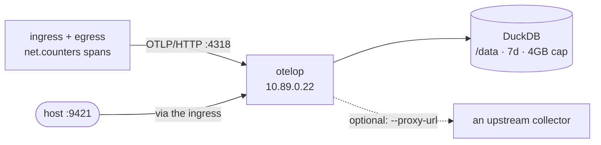

# Telemetry backend: otelop

[otelop](https://github.com/mashiro/otelop) — a local OpenTelemetry viewer in
a single binary: OTLP receivers, embedded DuckDB with retention, and a browser
UI with a GraphQL API.



## In the sandbox

| | |
| --- | --- |
| Image | `ghcr.io/mashiro/otelop:latest` |
| Address | `10.89.0.22` on `sandbox-ctrl` |
| OTLP HTTP | `http://10.89.0.22:4318/v1/traces` (also `/v1/logs`, `/v1/metrics`) |
| OTLP gRPC | `10.89.0.22:4317` |
| Web UI + GraphQL | container port `4319` (GraphQL at `/graphql`), reached from the host as **<http://127.0.0.1:9421>** through the ingress |
| Storage | named volume `otelop-data` at `/data`, DuckDB database |

The published image binds the UI to `0.0.0.0:4319` inside the container, which
is the opt-in the project asks for (the bare binary defaults to `127.0.0.1`
because the UI has no authentication). Reaching it still requires the ingress,
so nothing on the host is exposed by accident.

## Pointing something at it

```sh
export OTEL_EXPORTER_OTLP_ENDPOINT="http://10.89.0.22:4318"
export OTEL_EXPORTER_OTLP_PROTOCOL="http/protobuf"
export OTEL_TRACES_EXPORTER="otlp"
```

The controllers already do this by default (`OTEL_ENDPOINTS` in
`compose.yaml`). Querying the counters from the host:

```sh
curl -s http://127.0.0.1:9421/graphql \
  -H 'content-type: application/json' \
  -d '{"query":"{ status { storage { databaseSize } } }"}'
```

## Why it earns its place

- **Retention is built in** — a time window (`7d` by default) and a size
  ceiling (`4GB`), so a long-running sandbox does not fill its volume.
- **GraphQL** next to the UI, which makes it the easiest of the three to script
  against or query from an agent.
- **Optional forwarding**: `--proxy-url` can relay everything it receives to
  another collector, so it can sit in front of a more permanent store.

## Trade-offs

- **The UI is not the friendliest** of the three; the GraphQL API is where the
  power is.
- **Retention deletes data by design.** Anything you need to keep belongs
  somewhere else, or on another backend in this stack.

## Inspecting it

```sh
bin/sandbox logs telemetry-otelop
bin/sandbox exec telemetry-otelop otelop info    # resolved paths and config
podman volume inspect sandbox_otelop-data
```
